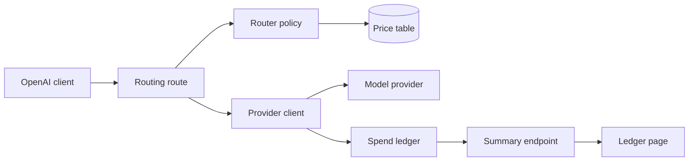

# Ledger Gateway

An OpenAI-compatible gateway that routes each request to the cheapest model that can do the job.



## Why

Small tools that talk to a model usually hardcode one endpoint, and that endpoint is the most expensive one, because nobody wants to think about routing per request. When a provider goes down mid-afternoon, those tools have no fallback and no record of what each call cost. Ledger Gateway sits in front of the providers, scores every chat completion request, sends it to the cheapest tier that can handle it, and keeps a ledger of tokens and spend so the cost of a feature is a number you can read.

## How it works

The gateway keeps the provider clients it already had and adds a routing layer in front of them. A request arrives on the routing route, `router_policy.decide` scores it and picks a tier, the client is called, and `ledger.record` appends one record with tokens and estimated cost. If the chosen provider raises, the route walks the fallback list the policy returned and retries on the next tier up.

The feature added on top of the base gateway is the cost-aware router. `src/api/router_policy.py` scores a request from its token estimate, message count and requested features, maps the score to a tier, and holds the price table and the fallback order. `src/api/ledger.py` appends one JSONL record per request and aggregates them into a summary. `src/api/routing_routes.py` exposes `POST /v1/route/chat/completions` and `GET /v1/route/ledger/summary`, calling the policy, the ledger and the client injected by `src/api/routes.py`. The router is registered in `src/api/server.py` next to the existing routers, and the three new settings live in `src/config.py` and `.env.example`.

## Key decisions

- Routing happens inside the gateway rather than in each client, so existing OpenAI-compatible callers only change their base URL. The cost is one more hop and a policy that has to stay honest about model prices.
- The ledger is an append-only JSONL file instead of a database table. It needs no migration and survives a restart, but summaries are recomputed by reading the file, which is fine at the volumes one gateway sees.
- Fallback is a fixed tier order rather than a retry against the same provider. A request that fails on the primary lands on the next tier instead of failing twice, at the price of a slightly weaker model for that call.
- The policy scores requests from cheap signals (estimated tokens, message count, tool use) rather than calling a classifier model. It adds milliseconds instead of a second round trip, and it will misjudge unusual prompts.

## Tech stack

- Python 3.9
- FastAPI and Uvicorn
- Pydantic v2
- OpenAI Python SDK (used by the CLI and the tests)
- Docker and Docker Compose
- pytest

## Quick start

Prerequisites: Python 3.9 or newer, and Docker with Compose if you run the container.

```bash
cp .env.example .env
pip install -r requirements.txt
python -m src.api.server
```

Or with Compose:

```bash
docker compose up --build
```

| Variable | What it sets | Default |
| --- | --- | --- |
| `PROVIDER` | Which provider the gateway talks to | `chatgpt` |
| `API_HOST` | Address the API server binds to | `0.0.0.0` |
| `API_PORT` | Port the API server listens on | `8000` |
| `API_TOKEN` | Bearer token required on API calls, empty disables auth | empty |
| `LEDGER_PATH` | File the spend ledger appends to | `logs/ledger.jsonl` |
| `ROUTER_DEFAULT_TIER` | Tier used when a request cannot be scored | `standard` |
| `ROUTER_FALLBACK_ENABLED` | Whether a failed tier falls back to the next one | `true` |

## Usage

```bash
curl -s http://localhost:8000/v1/route/chat/completions \
  -H "Authorization: Bearer dummy123" \
  -H "Content-Type: application/json" \
  -d '{"model":"auto","messages":[{"role":"user","content":"Summarise this invoice in one line."}]}'
```

```json
{
  "id": "route-7f3c1a",
  "model": "cheap-tier",
  "tier": "cheap",
  "score": 0.18,
  "fallback_used": false,
  "usage": {"prompt_tokens": 24, "completion_tokens": 31, "total_tokens": 55},
  "estimated_cost_usd": 0.000041,
  "choices": [{"index": 0, "message": {"role": "assistant", "content": "Invoice 4417 from Northwind Supply, 1,240.00 EUR, due 30 days."}}]
}
```

The spend so far:

```bash
curl -s http://localhost:8000/v1/route/ledger/summary -H "Authorization: Bearer dummy123"
```

```json
{"requests": 1284, "total_tokens": 918442, "estimated_cost_usd": 2.71, "by_tier": {"cheap": 902, "standard": 331, "strong": 51}}
```

## Project structure

```text
src/
  api/
    server.py          FastAPI app, auth middleware, router registration
    routes.py          Chat and thread routes, client injection
    router_policy.py   Request scoring, tiers, price table, fallback order
    ledger.py          JSONL spend ledger and summary
    routing_routes.py  Routing and ledger endpoints
  config.py            Settings read from the environment
  chatgpt/             Provider client
  claude/              Provider client
  minimax/             Provider client
tests/
```

## Limitations

- The price table is a static dict, so a provider price change needs a code edit.
- The ledger is a local file; two gateway instances writing to the same path will interleave records.
- The score is a heuristic and does not look at the content of the prompt beyond its length and shape.
- Streaming responses are not routed yet; only non-streaming chat completions go through the policy.

## License

MIT. This project builds on [CatGPT-Gateway](https://github.com/GautamVhavle/CatGPT-Gateway), which is also MIT licensed.
